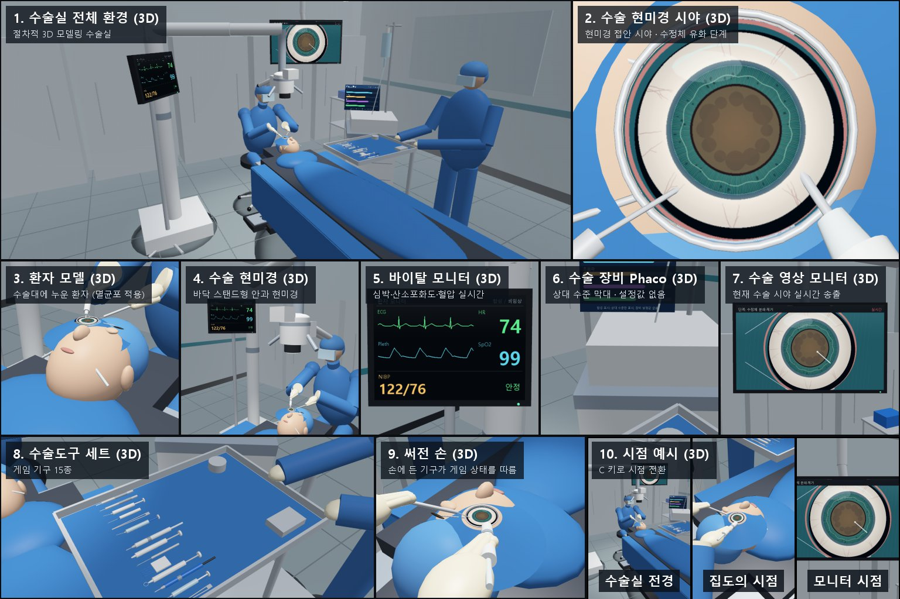

# Cataract Surgery Simulator — OphthoSim-AI

**Source update (2026-11-04):** Guarded axial instrument rotation (Z/C), recorded roll,189 native numerical-boundary checks and35 focused engine regressions are now implemented. These component checks do not establish a complete operation or a new Godot Windows release. Curved ocular lighting and a batched branching
vascular mesh are implemented, with focused11-suite checks and actual GPU static
view comparisons. This source update is not yet included in a newly qualified
Windows release. Complete surgery and interactive mechanics remain unfinished;
[current progress](docs/REALISM_COMPLETION_KO.md) includes the GPU capture and
remaining completion criteria.

**Development checkpoint (2026-10-29):** The professional surgical simulator is
still in development. The optional precise tissue path now restores a rejected
application tick atomically and pauses safely;143native regressions and scoped
application/engine checks pass. Continuous extraction, actual precise knife input,
interactive performance and a new validated Windows build remain unfinished.
See [current realism completion criteria](docs/REALISM_COMPLETION_KO.md) for the
latest evidence. Earlier release results below qualify their own implementations.

**Current version (2026-10-27):** The default Godot application is an integrated specialist simulation game: preparation, microscope/theatre, two persistent instruments, continuous incision, numerical capsule interaction, nuclear/cortical material, local hydraulic adhesion release and cortical aspiration, equipment pedals, continuous tip contact on shared anatomical surfaces, elastic IOL delivery, final inspections, debrief and recorded visual review. The intended feel is a detailed vehicle/flight simulator. Tissue models remain uncalibrated approximations; this is not a clinically validated surgical trainer.

Run `tools/run-godot.ps1` or the new Windows release `godot/build/OphthoSim-Surgical.exe` beside its `.pck`. [Current Korean guide](docs/SPECIALIST_SIMULATOR_KO.md) · [Current validation](docs/SPECIALIST_VALIDATION.md). `-Game` opens the earlier procedural edition. Historical Python and Godot notes below describe their own versions, not the default mode.

## Godot 3D game edition (2026-10-26)

The repository now also contains a **dedicated Godot 4.7.2 3D game** in [`godot/`](godot/). It includes an operating room and microscope view, seven selectable instruments, continuous entry/capsule tasks, regional lens/cortex removal, IOL delivery and alignment, three hazard scenarios, a Korean interface, patient monitor, depth diagram, assessment and version-2 semantic replay export.

On Windows, run the delivered `godot/build/OphthoSim.exe` beside its `.pck`, or run from source:

```powershell
powershell -ExecutionPolicy Bypass -File tools/run-godot.ps1 -Game
```

[Korean game guide and controls](docs/GODOT_GAME_KO.md) · [Godot validation and limitations](docs/GODOT_VALIDATION.md) · [Approved migration design](docs/superpowers/specs/2026-10-26-godot-surgery-design.md).

The Python/ModernGL edition and its historical progress follow below. Godot has its own independent tests and replay format. This is a playable stylized educational game; physically accurate tissue mechanics, photorealism and clinical training validation are not claimed.


---

## Python educational edition

An open-source, **educational and research** cataract microsurgery game written in
Python. You play a complete *abstracted* encounter from pre-operative verification to
the explained results screen, in a 2.5D microscope view or an experimental
hardware-accelerated 3D view, with a synthetic patient chart and monitor, fifteen
instruments chosen for the situation, bleeding, thirteen deterministic scenarios, three
difficulty levels, Korean/English UI and replayable research logs.

> **Not a medical device and not surgical training.** Every value, waveform,
> complication and score is synthetic game feedback. The procedure order and the
> instrument for each situation follow real cataract surgery, but there are no drug
> doses or device energy/vacuum/flow settings. See [Safety](docs/SAFETY.md).



Screenshots of every screen are produced by CI (`build/screenshots/` artifacts of the
*Tests* and *Software OpenGL Smoke* workflows).

## Quick start (Windows, Python 3.12+)

```powershell
python -m pip install -r requirements.txt
python main.py                                   # 2.5D game
python main.py --case motion --difficulty hard --lang ko
python main.py --resume                          # continue the autosaved case

python -m pip install -r requirements-3d.txt
python -m ophthosim.gl_surgery --case decenter   # experimental 3D game (OpenGL 3.3)
```

Korean step-by-step guide: [사용자 가이드](docs/USER_GUIDE_KO.md).
Submission-readiness review: [출품 준비 검수](docs/SUBMISSION_REVIEW_KO.md).
Windows folder-build instructions and current limits:
[Windows 실행본](docs/WINDOWS_DESKTOP_KO.md). The new shared entry point is
`python desktop.py` (Korean 3D by default; `--mode 2d` selects 2D).

## The encounter

1. **Pre-op review** — read the synthetic patient chart (age, conditions, drug classes,
   baseline vitals) and tick identity, operative site and planned IOL.
2. **Anesthesia & preparation** — confirm readiness (no medication actions).
3. **Entry** — main incision with the keratome, two side ports with the side-port knife,
   then viscoelastic (OVD, `V`) to deepen the chamber.
4. **Capsulorhexis** — cystotome/forceps along the circular guide. Without OVD the safe
   band narrows; pulling outwards makes the rhexis run out (**rhexis tear**).
5. **Hydrodissection** (`D`) and **phaco**, then 6. **I/A cortex cleanup** — work inside
   the working field; skipping hydrodissection or working at the edge builds *tissue
   stress* that can tear the posterior capsule.
7. **IOL** — viscoelastic in the bag, then the injector near the optical centre.
8. **Final checks** — alignment, wound, handoff.
9. **Results** — explained score, ending and event timeline.

### Instruments

Nine procedure instruments (keratome, side-port knife, OVD cannula, cystotome, forceps,
hydrodissection cannula, phaco, I/A, IOL injector) and six situation instruments (IOL
hook, iris hooks, capsular tension ring, cautery, irrigation, suture). In tutorial and
standard the scrub nurse hands you the stage instrument; situation instruments are
always your choice (tray or `T` / `Shift+T`). Using an instrument that does not fit
the situation is rejected and costs safety points.

### Complications and how they are managed

A complication first raises a **safety hold** (`A` assess or `X` stop safely). After
assessing it stays *pending* until you manage it with the right instrument at the
right place. Only the tutorial names that instrument. Continuing the task through a
**major** complication is a failure.

| # | Case | Synthetic event | Manage with |
|---|---|---|---|
| 1 | normal | none | — |
| 2 | motion | patient moves during the rhexis | assess (vitals settle) |
| 3 | vitals | monitor alarm during phaco | assess |
| 4 | capsule | posterior capsule rupture (**major**) | `B` call senior (sulcus IOL) or `X` |
| 5 | pupil | pupil constriction (diabetes) | iris hooks at the pupil margin |
| 6 | haze | corneal haze (Fuchs) | assess |
| 7 | decenter | IOL decentration | IOL hook at the centre |
| 8 | leak | wound leak at the final check | suture at the main incision |
| 9 | iris | iris prolapse (alpha-blocker) | iris hooks; ignored → iris trauma → hyphema |
| N | zonules | zonular weakness (pseudoexfoliation) | CTR; ignored → dialysis → capsule rupture |
| N | bleed | incision bleeding (anticoagulant) | cautery at the incision |
| N | hyphema | blood layering in the chamber, grows while ignored | irrigation |
| N | sch | suprachoroidal haemorrhage (**major**): red reflex lost | suture the wound; the case stops safely |
| N | random | one of the above, drawn from the seed and logged | — |

Technique can also cause complications: a run-out rhexis (**rhexis tear**, managed
with OVD) that extends into a capsule rupture if you carry on. Anticoagulated patients
bleed more. Vital signs drift towards each patient's baseline.

### Difficulty (`D` on the pre-op screen)

| | tutorial | standard | hard |
|---|---|---|---|
| Target tolerances | wide | baseline | narrow |
| Guides (ghost rings) | yes | yes | no |
| Stage instrument | handed over | handed over | choose (`T`) |
| Managing instrument named | yes | no | no |
| IOL acceptance | ≥ 55 % | ≥ 65 % | ≥ 75 % |
| Unattended alert limit | none | 30 s | 15 s |

### Endings and score

Five endings: **Simulation complete**, **Complication managed**, **Complication
unresolved** (the case finished with a complication left unmanaged), **Safely aborted**
(a positive outcome, not a failure) and **Critical failure** (an unattended safety hold
past the limit, or carrying on through a major complication).

The 100-point score is explained on the results screen. Each category is earned only
once that part has been evaluated:

| Category | Max | Basis |
|---|---|---|
| Stage completion | 20 | stages completed of 7 |
| Tissue protection | 25 | capsule integrity minus near-miss penalty |
| IOL position | 20 | final alignment |
| Complication response | 20 | recognition latency per alert (full credit ≤ 3 s), halved if left unmanaged |
| Patient safety | 15 | 0 on failure or an unresolved complication; deductions for technique (no OVD / hydrodissection), wrong instruments and stress warnings |

The weights are game-design hypotheses, not a validated skill measure.

## Controls

| 2.5D (`python main.py`) | |
|---|---|
| Mouse | stage task, or use the held situation instrument / checklists / instrument tray |
| Space | next pre-op item → start → prepare |
| 1–9, N, D | case, next case, difficulty (pre-op only) |
| T / Shift+T | next / previous instrument |
| V, D, B | viscoelastic, hydrodissection (phaco), call senior help |
| A / X / Esc | assess alert / safe abort / pause |
| Wheel or + −, [ ], , . | microscope zoom (locked while dragging), focus, illumination |
| L, H, C, M, S, F1 | language, high contrast, colour-safe palette, reduced motion, sound, help |
| G | CPU 3D mesh preview (read-only) |
| E, R | export logs, restart |

The 3D game (`python -m ophthosim.gl_surgery`) uses the same engine and keys for the
procedure, plus arrows to orbit, Q/E for tool depth, F3 for frame time and S to export.
Complications, bleeding and the devices used to manage them are drawn in both views.
`C` cycles from the operating microscope to a 3D **operating room**: the view through
the eyepieces, the whole theatre, the surgeon's view and the video monitor. The room has
the draped patient, a floor-stand microscope, a surgeon whose gloved hands hold the
current instrument, a scrub nurse, an instrument tray with all 15 instruments, and live
vital-signs, phaco and video displays. Mouse surgery stays in the microscope view.
`python -m ophthosim.or_gallery` renders all ten panels of the
[room concept](docs/V4_OPERATING_ROOM_3D_PLAN_KO.md) to `build/or_gallery/`.
Licensed OBJ models in `assets/models/` can replace the procedural eye
([format](assets/models/README.md)).

## Research and data

Every session is deterministic for a given case, seed and difficulty. **E** (2.5D) or
**S** (3D) writes these files to `session_logs/`:

- `*.jsonl` — the event trace
- `*.replay.jsonl` — the command journal with SHA-256 integrity
- `*.events.csv` and `*.metrics.csv`
- `*.report.json` — the explained score and timeline in the chosen language

```bash
python -m ophthosim.verify_replay session_logs/case_normal_standard_seed_7.replay.jsonl
python -m ophthosim.experiments examples/experiment_demo.json --out build/experiments/demo
```

The experiment runner plays scripted synthetic agents (ideal, careless, slow,
unresponsive) over case × difficulty × seed grids. It writes a metrics CSV, a JSONL
file of runs and a summary, and verifies every replay. The demo config runs 192
sessions in about a second. The metrics are:

- phase times
- near misses
- rejected inputs and wrong-tool uses
- action path length
- IOL attempts and pauses
- alert-recognition latency

Agents validate the instrument only; they say nothing about human performance. See the
[research plan](docs/RESEARCH_PLAN.md).

Autosave: both apps keep `session_logs/autosave.replay.jsonl` up to date on every
phase change and on quit, and `--resume` rebuilds the exact state from the verified
journal. Tampered autosaves are rejected.

## Accessibility

- Korean and English UI. On Windows the Korean UI uses Malgun Gothic.
- High-contrast and Okabe-Ito colour-safe palettes. No state is conveyed by colour
  alone.
- Reduced motion freezes animations without hiding alerts.
- Alerts are non-flashing, with an optional gentle tone and a text equivalent.
- Microscope zoom.
- The 3D HUD scales by an integer factor at 1440p and 4K.
- Alert timers are disabled in tutorial mode.

## Performance tools (3D)

```powershell
python -m ophthosim.gl_benchmark --seconds 60 --size 1920x1080             # GL08 frame time
python -m ophthosim.gl_benchmark --seconds 300 --scene-switch-every 120    # GL07 memory
```

Reports record mean, P50, P95 and P99 frame times, the cost of the proximity query
and of the render call, and the host-memory trend with a late-half slope. They also
record the OpenGL renderer strings. Software renderers are never counted as hardware
evidence. The HUD texture is uploaded zero-copy. See the
[GPU validation checklist](docs/GPU_VALIDATION_CHECKLIST.md).

## Status

| Area | State |
|---|---|
| Full 2.5D game: 13 scenarios, 15 instruments, bleeding, patient profiles, 3 difficulties, 5 endings, explained score, KO/EN, accessibility, autosave | **Implemented and tested** (876 automated tests on Windows) |
| 3D game with the same engine, complication/bleeding signs, 3D operating room (5 views, gallery) | Implemented; GPU smoke and gallery passed on Windows 11 / RTX 3070 |
| Windows GPU (GL01–GL10) | NVIDIA RTX 3070: automated checks pass; AMD Radeon target and human sign-off **open** ([checklist](docs/GPU_VALIDATION_CHECKLIST.md)) |
| Clinical plausibility and educational value | **Open** — needs subject-matter-expert review |
| Vitreous event, deformable tissue physics | Out of scope for v1.x (spec "advanced") |

See the [32-work-package status](docs/ROADMAP.md#implementation-status-2026-10-24) and the
[development log](docs/CHANGELOG.md).

## Project layout

```
ophthosim/
  engine.py           phase machine, rules, hazards, endings, score breakdown, metrics
  replay.py           deterministic command journal + integrity-checked replay (schema v3)
  report.py           explained report, timeline, CSV/JSON export
  experiments.py      scripted synthetic agents and batch runs
  autosave.py         verified recovery points
  i18n.py             Korean/English strings
  app.py              2.5D Pygame game
  gl_surgery.py       experimental ModernGL 3D game (+ input3d, contact3d, tool3d,
                      iol3d, capsule3d, complication3d, vision3d, surface_probe3d …)
  assets.py           optional licensed OBJ models (licence manifest required)
  room3d.py           procedural operating room, instruments, people, cameras
  screens3d.py        in-room displays (vitals, phaco, video, eye texture)
  gl_room.py          room renderer (lit shader, MSAA); or_gallery.py panel renders
  gl_preview.py       3D anatomy atlas and renderer
  gl_benchmark.py     frame-time / memory benchmark; frametime.py statistics
tests/                876 headless, SDL-dummy and GUI tests
docs/                 specs (KO), architecture, roadmap, safety, research, GPU checklist
```

## Documentation

- [사용자 가이드 (한국어)](docs/USER_GUIDE_KO.md)
- [3D 실행·조작 안내](docs/INTERACTIVE_3D_USAGE_KO.md)
- [Product spec (KO)](docs/PRODUCT_SPEC_KO.md)
- [Visual design (KO)](docs/VISUAL_DESIGN_KO.md)
- [Technical architecture](docs/TECHNICAL_ARCHITECTURE.md)
- [Roadmap & WP status](docs/ROADMAP.md)
- [Test report](docs/TEST_REPORT.md)
- [Progress](docs/PROGRESS.md)
- [Safety](docs/SAFETY.md)
- [Research plan](docs/RESEARCH_PLAN.md)
- [GPU validation checklist](docs/GPU_VALIDATION_CHECKLIST.md)
- [Development log](docs/CHANGELOG.md)

## License

See [LICENSE](LICENSE). External assets must document their provenance and
redistribution rights.
